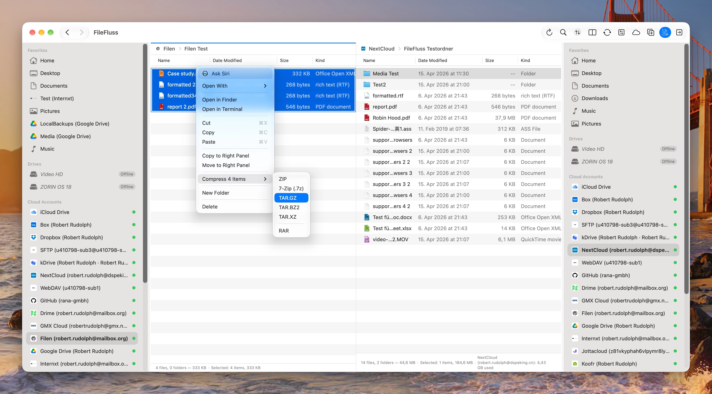
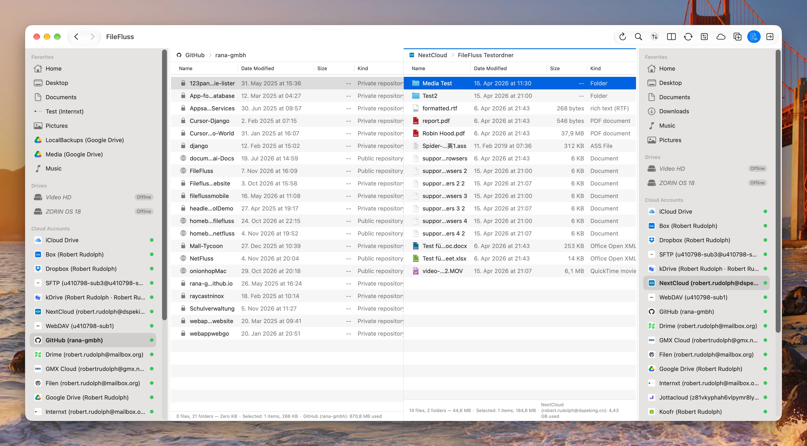
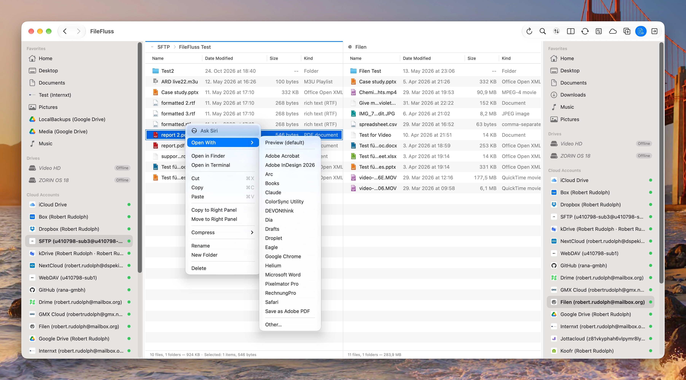

# FileFluss 1.6

Archives, three new kinds of storage, Open With, and a long list of work on what matters most in a file manager: that a copy, a move or a sync never costs you a file.

## Archives, right in the panel



Double-click a ZIP, RAR, 7z or TAR archive and it opens in the panel like a folder — on your Mac and on any cloud account. Inside, folders navigate as usual, and the breadcrumb and history work unchanged.

- **Preview** any file inside with Quick Look, or open it, without unpacking the rest.
- **Drag single files or folders out** to the other panel or to Finder, or choose *Extract to … Panel*.
- **Extract Here** and **Extract to the other panel** for the whole archive, following Finder's rule: one item lands as itself, several go into a folder named after the archive.
- **Compress** to ZIP, 7-Zip, TAR.GZ, TAR.BZ2 or TAR.XZ from the right-click menu.

On a cloud account it all works the same way: the archive is downloaded, unpacked or packed, and the result uploaded beside it. Nothing is unpacked until you actually ask for an entry, and archive entries that try to escape their folder are refused.

RAR archives open out of the box. *Creating* RAR needs RARLAB's own tool, since no free encoder exists — FileFluss offers to fetch it from rarlab.com, checked against a pinned checksum.

## Back up your GitHub repositories, and three new NAS brands



**GitHub** can now be connected with a personal access token. The panel lists your owners and repositories, shows at a glance which ones are private, and offers each repository both as browsable files and as a snapshot ZIP of its default branch. Drag those snapshots onto Dropbox, a NAS or any other account, and your repositories are backed up — as an ordinary panel-to-panel copy. GitHub accounts are read-only, so nothing can be deleted there by accident.

**New NAS support**, in a new NAS section of Add Account alongside Synology:

- **QNAP** — signs in to File Station with your QTS account, including 2-step verification, and creates share links.
- **UGREEN** and **ASUSTOR** — connect through the NAS's built-in WebDAV service, with each maker's default port.

All three accept a self-signed certificate. That also fixed downloads from Synology units that use one.

**Drime**, the French cloud storage service, joins as a new provider: browse, upload (in parallel parts for large files), download, move and copy on the server, rename, delete to the Drime trash, storage quota, and share links with password, expiry and a download switch.

## Open With



The right-click menu now has an **Open With** submenu, like Finder's: the default app first, then every other app that can open the selection, and *Other…* to pick any app. It works on your cloud drives too — open a Dropbox or NAS file straight in the app of your choice. A mounted account opens the file in place; otherwise it's downloaded first. With several files selected, only apps that open all of them are offered.

## Sync and large copies you can rely on

The biggest part of this release is invisible when it works. I went through every path that copies, moves, replaces or syncs a file and closed the ones that could lose data:

- **A move deletes the source only once everything has arrived** — including folders that only partly downloaded.
- **Replace never leaves you with nothing.** The new copy is written under a temporary name and swapped in once complete, in sync, in manual Replace and in the conflict dialog. *Keep Both* on a cloud download no longer deletes the existing file.
- **Mirror stops instead of guessing.** A folder it can't read, a listing it can't parse or an unsafe path stops the sync, and it refuses to empty a destination. Syncs involving this Mac leave hidden files alone on both sides.
- **A repeated sync has nothing to do.** Copies now keep the source's modification date, a sync runs exactly what was calculated, and *Update Newer* leaves folders alone.
- **Large files upload in pieces** on Google Drive, OneDrive and Dropbox instead of being read into memory first, and downloads are swapped in only once complete.
- **Cancel means cancel**, at once, including SFTP and FTP transfers. The Mac stays awake during a transfer, and quitting mid-transfer asks first.
- **SFTP and FTP no longer hang** on very large folders.

## Security

- The Finder mount rejects paths containing `..`, and sync writes stay inside the folder you chose.
- Login details are sent only to their own host, including after redirects and for WordPress media downloads.
- Archives with unsafe entries are refused, and file names can no longer be read as options by the archiving tools.
- Downloaded files carry the quarantine flag, so Gatekeeper checks them like anything else you download.
- Add Account warns before you connect to a server over plain HTTP.

## Translations

Around 245 texts were written straight into the code and never reached the translation files — dialog titles, error messages, transfer status lines and the error messages of most cloud providers. German, Simplified Chinese and Traditional Chinese users read them in English. All of them are translated now, and a new test keeps new English-only text from creeping in.

## Fixes

- **No more crash when a drag ends over a file list.** It had been possible since 1.5 and was easiest to hit by dragging out of an archive. Thanks to the user who reported it.
- **A refused Trash names the real cause.** FileFluss always pointed at Full Disk Access, even for users who had already granted it. It now checks whether the Trash folder itself is the problem — for example one owned by another user — and offers a command that repairs it.
- **An expired sign-in keeps the panel usable**, with a way to sign in again, and accounts stuck offline recover at launch.
- **Your account list and favourites are safe from a damaged entry**: one that can't be read is kept aside rather than risking the whole list, and a damaged search index rebuilds itself.
- **Local panels follow changes made outside FileFluss**, keep their selection during a refresh, and show local errors.
- **The conflict question always appears**, queues when several arrive at once, and ends cleanly on Cancel.
- Tab moves keyboard focus, and the hidden-files, Quick Look and Settings shortcuts work again.

## Install

```bash
brew trust rana-gmbh/filefluss && brew install --cask rana-gmbh/filefluss/filefluss
```

Already have FileFluss? `brew upgrade --cask filefluss`, or let the app update itself.
